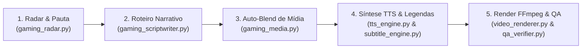

# Guia do Agente Diretor — GTA 6 Shorts Studio

> Documento oficial de diretrizes e comandos para o agente de desenvolvimento e automação.
> Foco: Produção autônoma e assistida de **YouTube Shorts sobre GTA 6 e Rockstar Games** (1080×1920 • $\le 58,0$ s • Sem chaves de API obrigatórias — serviços externos opcionais: Edge-TTS, Pollinations, Gemini).

---

## 0. Regras Obrigatórias de Trabalho (Não Negociáveis)

0. **Não reimplemente o que já existe**: Antes de implementar qualquer melhoria, confira a seção "Já implementado" do `ARCHITECTURE.md` e o `git log`. Não reimplemente o que já existe.
1. **Uma tarefa por vez**: Não inicie a tarefa seguinte sem a anterior ter testes passando e estar validada.
2. **Sem decisões arquiteturais unilaterais**: Se uma tarefa exigir mudar a estrutura de pastas, trocar bibliotecas ou alterar o modelo de dados de forma incompatível, pare e pergunte ao usuário.
3. **Não reescreva do zero**: Preserve o comportamento atual (FastAPI + FFmpeg + SPA em JS puro + processamento local). Refatore em incrementos pequenos.
4. **Teste de caracterização prévio**: Antes de alterar qualquer módulo, escreva ou rode um teste que fixe o comportamento atual.
5. **O código é a fonte da verdade**: Não confie cegamente em documentações legadas. Verifique sempre a implementação real no código.
6. **Nenhuma exceção engolida**: Todo `except` deve registrar log com contexto (`logging.warning/exception`); nunca use `except: pass`.
7. **Compatibilidade Multiplataforma**: O projeto é testado em Windows e deve manter compatibilidade com Linux e macOS (caminhos com `Path`, sem barras invertidas fixas ou chamadas exclusivas de `.exe`).
8. **Atualização contínua de documentação**: Ao concluir cada tarefa, atualize `ARCHITECTURE.md`, `ROADMAP.md` e `CHANGELOG.md` informando: arquivos alterados, testes adicionados e pendências/riscos.

---

## 1. Fluxo Operacional de Produção

- **Painel Web (`static/index.html`):** **4 passos visuais** (`1. Radar & Pauta` → `2. Roteiro & Locução` → `3. Cenas & Mídia` → `4. Render, QA & Entrega`).
- **Fila de Produção em Lote (`app/job_queue.py`):** **5 estágios sequenciais** (`pesquisa` → `roteiro` → `tts` → `render` → `qa`):



### Passo 1 — Radar e Pauta (`app/gaming_radar.py`)
- Monitora tendências via Google Trends RSS (`geo=BR` e `geo=US`) e Google News.
- Higieniza títulos e identifica matérias de games (Rockstar, GTA 6, Take-Two, vazamentos, trailers).
- Classifica confiabilidade e descarta duplicatas antes da geração.

### Passo 2 — Roteiro Narrativo (`app/gaming_scriptwriter.py`)
- Gera a narrativa estruturada com gancho viral nos primeiros 3 segundos ($\le 24$ palavras).
- Adapta a linguagem conforme a confiabilidade: fatos confirmados são afirmados; rumores exigem linguagem de incerteza ("segundo rumores", "supostamente").
- Garante orçamento de palavras e ritmo compatível com o teto de **58,0 segundos**.

### Passo 3 — Seleção de Mídia e Procedência (`app/gaming_media.py`)
- Prioriza cortes em movimento dos trailers locais (`inputs/gta6/*.mp4`).
- Consulta o catálogo [inputs/media_catalog.json](inputs/media_catalog.json) e registra a procedência e licença de cada corte e trilha sonora utilizada no projeto (`project.used_media`).
- Seleciona trilha synthwave/rock local calculando o ponto de início ideal.

### Passo 4 — Síntese Vocal e Legendas Dinâmicas (`app/tts_engine.py` & `app/subtitle_engine.py`)
- Gera voz neural em português do Brasil (`pt-BR-AntonioNeural` a +14%) via Edge-TTS.
- Extrai timestamps de início e fim por palavra (`WordTiming`).
- Queima legendas ASS estilizadas estilo Vice City neon no terço inferior, respeitando a safe zone do YouTube Shorts.

### Passo 5 — Renderização e Controle de Qualidade (`app/video_renderer.py` & `app/qa_verifier.py`)
- Concatena clipes 1080×1920 (9:16) a 30 fps em H.264/AAC.
- Aplica ducking de áudio (trilha atenuada sob a narração e cheia no clímax final).
- Executa QA automatizado: ffprobe (resolução, duração $\le 58,0$ s), EBU R128 (loudness LUFS e True Peak) e auditoria de direitos de mídia.
- Gera prancha de contato visual (`contact_sheet.png`) e resumo executivo (`project_packed.md`).

---

## 2. Comandos Reais da CLI (`cli.py`)

A interface de linha de comando suporta estritamente os seguintes subcomandos:

```bash
# 1. Consultar pautas em alta no radar de GTA 6
python cli.py radar --query "GTA 6" --geo "BR"

# 2. Criar roteiro e montagem para um tópico específico
python cli.py create --topic "Data de Lancamento de GTA 6" --archetype "auto"

# 3. Criar e imediatamente renderizar o vídeo final
python cli.py create --topic "Preco Oficial GTA 6" --render

# 4. Renderizar um projeto existente pelo ID
python cli.py render --project-id "gta6-preco-oficial-gta-6-1a2b3c"

# 5. Listar todos os projetos cadastrados e status de renderização
python cli.py list

# 6. Criar lote de Shorts a partir das melhores pautas do dia
python cli.py batch --count 5
```

---

## 3. Estrutura de Diretórios Essenciais

- `app/`: Módulos centrais da aplicação (servidor web, radar, roteirista, mídia, áudio, render e QA).
- `inputs/`: Mídias brutas e catálogo de licenças (`media_catalog.json`).
- `projects/`: Diretório de trabalho de cada projeto (`project.json`, áudios `.wav`, cortes e relatórios de QA).
- `outputs/`: Vídeos finais renderizados (`single_video.mp4`) e capas (`thumbnail.png`).
- `static/`: Interface Web SPA (HTML, CSS e JS puro com tema Vice City Neon).
- `tests/`: Bateria de testes automatizados com `pytest`.
