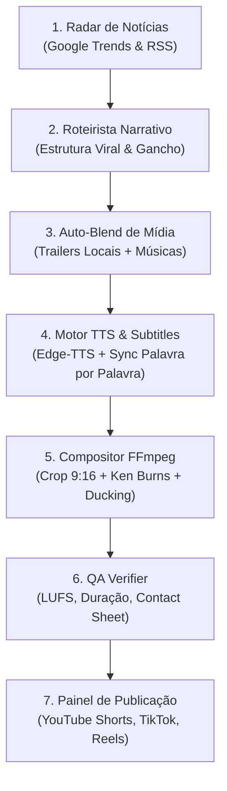
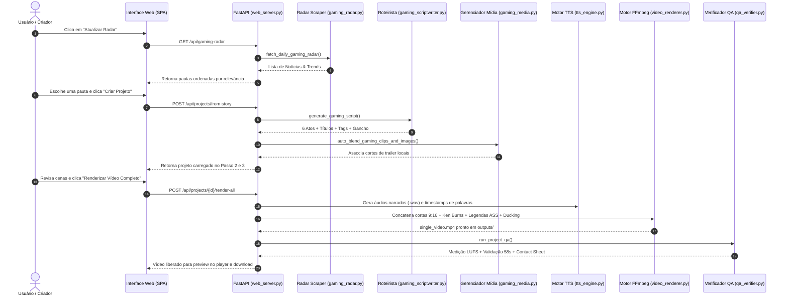

# 📚 DOCUMENTAÇÃO TÉCNICA E ARQUITETURAL COMPLETA — GTA 6 SHORTS STUDIO

> **Fábrica Autônoma de YouTube Shorts sobre GTA 6 e Rockstar Games**  
> **Formato:** 1080×1920 (9:16 Vertical) • **Teto de Duração:** $\le 58,0$ segundos (decisão editorial de retenção) • **Filosofia:** Sem API paga por padrão (Local-First com serviços externos opcionais) • **Locução:** Neural PT-BR com Timestamps de Palavras  
> **Repositório:** `D:\CriadorDeVideos`  
> **Última Atualização:** 16 de Novembro de 2026

---

## SUMÁRIO GERAL

1. [Visão Geral e Propósito](#1-visão-geral-e-propósito)
2. [Pilha Tecnológica e Dependências](#2-pilha-tecnológica-e-dependências)
3. [Agentes e Subagentes no Ecossistema](#3-agentes-e-subagentes-no-ecossistema)
4. [Skills e Especializações Ativas](#4-skills-e-especializações-ativas)
5. [Arquitetura de Módulos (Backend Python)](#5-arquitetura-de-módulos-backend-python)
6. [Modelagem de Dados e Schemas Pydantic](#6-modelagem-de-dados-e-schemas-pydantic)
7. [Fluxo Operacional Ponta a Ponta (Pipeline)](#7-fluxo-operacional-ponta-a-ponta-pipeline)
8. [Interface Frontend (SPA Vice City Neon)](#8-interface-frontend-spa-vice-city-neon)
9. [Matriz de Rotas da API REST (FastAPI)](#9-matriz-de-rotas-da-api-rest-fastapi)
10. [Interface de Linha de Comando (CLI)](#10-interface-de-linha-de-comando-cli)
11. [Controle de Publicação e Rastreamento](#11-controle-de-publicação-e-rastreamento)
12. [Diagnóstico de Limitações e Plano de Evolução](#12-diagnóstico-de-limitações-e-plano-de-evolução)

---

## 1. VISÃO GERAL E PROPÓSITO

O **GTA 6 Shorts Studio** é uma plataforma desenvolvida para criação autônoma e semiautomática de vídeos verticais (YouTube Shorts, Instagram Reels, TikTok) focada no universo de **Grand Theft Auto VI** e no ecossistema da **Rockstar Games**.

### Objetivos Chave:
- **Produção em Escala:** Capacidade de gerar de 5 a 10 vídeos diários a partir de tendências reais de notícias e buscas.
- **Filosofia Local-First / Zero-API:** O sistema opera com custo zero de infraestrutura e sem obrigação de chaves pagas de API:
  - Scrapers locais de RSS e notícias abertas;
  - Banco local de trailers oficiais cortados em alta definição (`inputs/gta6/*.mp4`);
  - Biblioteca local de trilhas sonoras synthwave/neon (`inputs/gta6/*.mp3`);
  - Síntese de voz neural estéreo via `edge-tts` (`pt-BR-AntonioNeural`);
  - Renderização física através do motor FFmpeg via filtergraphs avançados.
- **Suporte Híbrido Opcional:** Caso configurada uma chave `GEMINI_API_KEY`, o sistema pode consultar o modelo `gemini-2.5-flash` para refinar ganchos virais e roteiros.



---

## 2. PILHA TECNOLÓGICA E DEPENDÊNCIAS

| Camada | Tecnologia / Biblioteca | Versão Alvo | Finalidade |
| :--- | :--- | :--- | :--- |
| **Linguagem & Runtime** | Python (CPython) | 3.14 (64-bit) | Execução de todo o backend, workers e scripts CLI. |
| **Framework Web** | [FastAPI](https://fastapi.tiangolo.com/) | $\ge 0.115.0$ | Exposição das rotas REST assíncronas do estúdio. |
| **Servidor ASGI** | [Uvicorn](https://www.uvicorn.org/) | $\ge 0.30.0$ | Servidor assíncrono para hosting local com `--reload`. |
| **Tipagem e Schemas** | [Pydantic v2](https://docs.pydantic.dev/) | $\ge 2.7.0$ | Validação estrita de contratos de dados e serialização JSON. |
| **Motor de Vídeo** | [FFmpeg / FFprobe](https://ffmpeg.org/) | $\ge 6.0$ | Renderização de vídeo, reamostragem, mixagem e análise EBU R128. |
| **Wrapper FFmpeg** | `imageio-ffmpeg` | $\ge 0.5.1$ | Localizador e fallback automatizado de binários FFmpeg no PATH. |
| **Voz Neural (TTS)** | [edge-tts](https://github.com/rany2/edge-tts) | $\ge 6.1.12$ | Síntese de fala gratuita com metadados de tempo de cada palavra. |
| **Downloader de Mídia** | [yt-dlp](https://github.com/yt-dlp/yt-dlp) | $\ge 2026.10$ | Indexação e download de trailers oficiais em 1080p/4K. |
| **Manipulação de Imagens**| [Pillow (PIL)](https://python-pillow.org/) | $\ge 10.4.0$ | Criação de capas 9:16, pranchas de contato e tratamento visual. |
| **Cálculo Numérico** | [NumPy](https://numpy.org/) | $\ge 2.0.0$ | Análise de envelopes de áudio e matrizes de frames. |
| **Cliente HTTP** | [HTTPX](https://www.python-httpx.org/) | $\ge 0.27.0$ | Requisições assíncronas para feeds RSS e APIs REST externas. |
| **Scraping HTML** | [BeautifulSoup4](https://www.crummy.com/software/BeautifulSoup/) | $\ge 4.12.0$ | Extração e limpeza do conteúdo textual de matérias de games. |
| **SDK Gemini** | [google-genai](https://github.com/googleapis/python-genai) | $\ge 2.30.1$ | Integração moderna com os modelos Google Gemini. |
| **Frontend** | HTML5 / Vanilla JS / CSS3 Moderno | Nativo | UI desacoplada, responsiva, tema escuro neon e sem bundlers. |

---

## 3. AGENTES E SUBAGENTES NO ECOSSISTEMA

O desenvolvimento e a manutenção da ferramenta contam com agentes especializados:

### 1. `Antigravity` (Agente Orquestrador Central)
- **Função:** Coordenação de todo o ciclo de vida do projeto, planejamento técnico, auditorias, refatorações, criação de testes e documentação.

### 2. Subagente `browser` (`YouTube Shorts Reference Analyzer`)
- **Função:** Inspeção visual automatizada no YouTube Shorts.
- **Ações:** Navegação em canais de sucesso (SanInPlay, IGN, GameSpot), extração de padrões visuais de safe-zones, cadência de corte e retenção de audiência.

### 3. Subagente `code-fixer` (`Ken Burns Fix Agent`)
- **Função:** Diagnóstico de baixo nível em filtergraphs complexos de FFmpeg.
- **Ações:** Resolução do bug de tremor de quadros na animação zoompan de imagens estáticas, padronizando o comando contínuo.

---

## 4. SKILLS E ESPECIALIZAÇÕES ATIVAS

No diretório `.agents/skills/` e no ecossistema Antigravity, as seguintes skills dão suporte ao projeto:

### 🎮 `gta6-shorts-director`
- **Arquivo de Instrução:** `.agents/skills/gta6-shorts-director/SKILL.md`
- **Diretrizes Estritas:**
  1. Vídeo vertical obrigatório 1080×1920 (9:16).
  2. Duração máxima de 58,0 segundos por decisão editorial para alta retenção (embora o YouTube aceite Shorts mais longos).
  3. Fundo visual sempre dinâmico, priorizando cuts locais dos trailers oficiais da Rockstar.
  4. Voz oficial `pt-BR-AntonioNeural` acelerada em +14% para maximizar retenção.
  5. Ducking de áudio obrigatório para que a narração nunca concorra com a trilha de fundo.

### 🌐 `chrome-devtools`
- **Finalidade:** Auditoria de acessibilidade, validação visual da UI, auditoria de consoles JavaScript e testes funcionais ponta a ponta na interface web do estúdio.

### 🧠 `gemini-api-dev`
- **Finalidade:** Documentação e boas práticas do SDK `google-genai` para prompts estruturados, fallbacks e schemas JSON controlados.

---

## 5. ARQUITETURA DE MÓDULOS (BACKEND PYTHON)

A lógica central reside no diretório [app/](file:///d:/CriadorDeVideos/app). Abaixo, a descrição técnica detalhada de cada módulo:

### `app/config.py`
- Resolve variáveis de ambiente (`.env`).
- Define diretórios-raiz:
  - `PROJECTS_DIR = D:\CriadorDeVideos\projects`
  - `OUTPUTS_DIR = D:\CriadorDeVideos\outputs`
  - `INPUTS_DIR = D:\CriadorDeVideos\inputs`
  - `FONTS_DIR = D:\CriadorDeVideos\fonts`
- Executa a função `get_ffmpeg_exe()`, que localiza o executável do FFmpeg (seja no sistema ou via `imageio_ffmpeg`).

### `app/models.py`
- Contém todas as classes Pydantic v2 que moldam o estado:
  - `SceneItem`: Representa uma cena individual (texto, duração, efeito visual, caminho de vídeo/imagem, enquadramento).
  - `WordTiming`: Contém a palavra falada e seu segundo exato de início e fim no áudio da narração.
  - `MusicStoryProject`: Classe mãe que guarda todo o estado de um vídeo (metadados do YouTube, tags, lista de cenas, status de renderização e publicação).
  - `GamingRadarItem`: Representa um item capturado nos feeds de notícias com nota de tendência (*trend score*).

### `app/gaming_radar.py`
- Motor de coleta de tendências.
- Monitora os feeds RSS do Google Trends (`geo=BR`, categoria jogos) e realiza buscas avançadas no Google News com termos-chave: `"GTA 6"`, `"Grand Theft Auto VI"`, `"Rockstar Games"`, `"Take-Two"`.
- Utiliza `HTTPX` para download e `BeautifulSoup` para higienização de HTML, extraindo títulos, fontes jornalísticas (ex: IGN, Voxel, Canaltech, The Enemy) e URLs de referência.

### `app/gaming_scriptwriter.py`
- Motor de inteligência narrativa.
- Transforma um título de notícia em um roteiro de 6 cenas:
  - **Ato 1 (Gancho Viral):** Frase de impacto com limite estrito de palavras ($\le 24$ palavras).
  - **Ato 2 (Curiosidade / Fato Imediato):** Contexto direto da novidade.
  - **Ato 3 (Aprofundamento Narrativo):** Detalhes da mecânica, mapa ou orçamento.
  - **Ato 4 (Conflito / Dado Técnico):** Comparações com GTA 5 ou vazamentos anteriores.
  - **Ato 5 (Clímax / Consequência):** O que isso significa para o lançamento.
  - **Ato 6 (CTA de Debate):** Pergunta que estimula comentários na plataforma.
- Gera título otimizado para YouTube Shorts, descrição com palavras-chave e hashtags relevantes.

### `app/gaming_media.py`
- Responsável pelo gerenciamento de mídia local.
- Faz a varredura em `inputs/gta6/*.mp4` para identificar trailers disponíveis.
- Sorteia ou seleciona trechos de 4 a 6 segundos com alta energia e movimento.
- Localiza trilhas sonoras locais em `inputs/gta6/*.mp3` e calcula o ponto de início ideal para casar com o clima do vídeo.

### `app/visual_assets.py`
- Fornece recursos visuais alternativos ou complementares.
- Conecta-se à API do Pollinations para geração de ilustrações conceituais no estilo Flux (`https://image.pollinations.ai/prompt/...`).
- Faz buscas de imagens históricas na Wikimedia Commons e gera backgrounds gradientes neon caso não haja trailer disponível.

### `app/tts_engine.py`
- Orquestra a síntese vocal usando `edge-tts`.
- Executa a voz `pt-BR-AntonioNeural` configurada com `rate="+14%"`.
- Converte eventos de áudio em tokens `WordTiming`, registrando os milissegundos exatos em que cada palavra foi dita para alimentar o gerador de legendas.

### `app/subtitle_engine.py`
- Constrói legendas dinâmicas em formato ASS (Advanced SubStation Alpha).
- Aplica posicionamento vertical seguro (acima da barra de tempo do YouTube Shorts).
- Estiliza fontes em caixa alta com cores neon Vice City (amarelo dourado `#FFE600` e ciano `#00F0FF`) e contorno preto espesso para legibilidade contra qualquer fundo.

### `app/video_renderer.py`
- O coração da montagem audiovisual via FFmpeg.
- Executa as seguintes transformações:
  1. Converte e redimensiona cada corte de trailer ou imagem para 1080×1920 (proporção 9:16).
  2. Aplica filtro contínuo de zoompan (Ken Burns) em imagens paradas.
  3. Queima as legendas ASS diretamente sobre o vídeo através do filtro `subtitles`.
  4. Junta os clipes de todas as cenas usando o demuxer `concat`.
  5. Combina a voz narrada (`volume=1.0`) com a música de fundo atenuada (`volume=0.12`).
  6. Exporta o vídeo final em codec H.264 (`yuv420p`), áudio AAC estéreo a 320 kbps e taxa de quadros de 30 fps.

### `app/thumbnail_engine.py`
- Gera a capa vertical (thumbnail 9:16) em resolução nativa 1080×1920.
- Extrai um frame de alta definição do trailer ou usa a imagem principal do projeto.
- Aplica vinheta escura no topo e na base, moldura neon ciano/magenta e tipografia pesada no terço superior da imagem com a manchete da notícia.

### `app/qa_verifier.py`
- Sistema de controle de qualidade automatizado pós-renderização.
- Verifica os seguintes parâmetros:
  - Existência e integridade física do arquivo MP4;
  - Resolução exata de 1080×1920;
  - Duração total $\le 58,0$ segundos;
  - Presença de streams H.264 e AAC;
  - Medição de Loudness Integrado (EBU R128), com alvo calibrado em $-14,0$ LUFS e True Peak $\le -1,0$ dBTP (o código legado reprova $< -28,0$ e alerta se $> +0,2$ dBFS; padronizado em C-13);
  - Geração de prancha de contato visual (`contact_sheet.png`) com 10 frames distribuídos e envelope de forma de onda do áudio (RMS).

### `app/web_server.py`
- Servidor web FastAPI principal que unifica todos os módulos através de endpoints HTTP REST e serve a interface estática do estúdio.

---

## 6. MODELAGEM DE DADOS E SCHEMAS PYDANTIC

O schema principal é a classe `MusicStoryProject` em `app/models.py`. Seus campos essenciais incluem:

```python
class MusicStoryProject(BaseModel):
    id: str                          # Identificador único (ex: gta6-trailer-2-analise-9b2f)
    niche: str = "gaming_news"       # Nicho do canal
    title: str                       # Título interno do projeto
    game: str = "GTA 6"              # Nome do jogo
    
    # Roteiro e Cenas
    scenes: list[SceneItem]          # Lista de cenas ordenadas (1 a 6)
    narration_full: str              # Texto completo da narração corrida
    hook_title: str                  # Frase de gancho da Cena 1
    max_duration_sec: float = 58.0   # Teto estrito de duração
    
    # Metadados de Publicação
    youtube_title: str               # Título otimizado para o YouTube (< 70 caracteres)
    youtube_description: str         # Descrição completa com links e créditos
    youtube_tags: list[str]          # Tags de busca
    hashtags: list[str]              # Hashtags de alta visibilidade (#GTA6, #Shorts)
    
    # Configuração Técnica
    speech_rate: str = "+14%"        # Velocidade da voz neural
    voice_name: str                  # Nome da voz (pt-BR-AntonioNeural)
    accent_color: str = "#00F0FF"    # Cor de destaque visual (Vice City Cyan)
    
    # Arquivos Gerados (Outputs)
    outputs: dict[str, str]          # Caminhos dos arquivos renderizados
    cover_image_path: str | None     # Caminho do pôster / capa gerado
    qa_report: dict[str, Any]        # Relatório de auditoria técnica e editorial pós-render
    used_media: list[dict[str, Any]] # Inventário de procedência, licenças e risco das mídias
    
    # Controle de Postagem
    is_posted: bool = False          # Indicador booleano de publicação
    posted_at: str | None = None     # Data e hora ISO da postagem
    posted_url: str | None = None    # Link real do vídeo publicado no YouTube
    posted_platform: str = "youtube" # Plataforma de destino
    
    # Timestamps
    created_at: str                  # Criação do rascunho
    updated_at: str                  # Última alteração salva
```

---

## 7. FLUXO OPERACIONAL PONTA A PONTA (PIPELINE)



---

## 8. INTERFACE FRONTEND (SPA VICE CITY NEON)

A interface é servida diretamente pelo FastAPI a partir do diretório `static/`:
- `static/index.html`: Estrutura semântica dividida em um **Stepper de 5 Etapas**:
  - **Passo 1 (Radar GTA 6):** Feed de tendências, busca personalizada por termo e botão de criação de lote diário.
  - **Passo 2 (Roteiro & Estrutura):** Painel de visualização da narrativa, edição do gancho e geração de novas versões.
  - **Passo 3 (Editor de Cenas & Mídias):** Timeline com cards de cada uma das 6 cenas, permitindo edição manual do texto de cada fala, troca de trailer de fundo e seleção de efeito.
  - **Passo 4 (Renderização & QA):** Player de vídeo HTML5 vertical, download do MP4 final, prancha de inspeção de frames e controle de publicação.
  - **Passo 5 (Gerenciador de Canal):** Tabela de controle de publicações com links para os Shorts postados e histórico de datas.
- `static/app.js`: Gerenciador de estado local, funções assíncronas `fetch`, polling de progresso de renderização em tempo real e alternância de status de postagem com um clique.
- `static/styles.css`: Estilização cinematográfica com variáveis CSS, fontes modernas, paleta inspirada no visual noturno de Vice City (fundo grafite escuro, acentos em ciano elétrico `#00F0FF` e rosa magenta neon `#FF007F`).

---

## 9. MATRIZ DE ROTAS DA API REST (FASTAPI)

| Método | Endpoint | Parâmetros / Body | Descrição |
| :--- | :--- | :--- | :--- |
| `GET` | `/api/gaming-radar` | `query`, `geo` | Busca pautas quentes sobre GTA 6 no Google Trends e Google News. |
| `GET` | `/api/projects` | — | Lista todos os projetos salvos em `projects/`. |
| `GET` | `/api/projects/{id}` | `id` (path) | Retorna os detalhes completos do JSON do projeto. |
| `POST` | `/api/projects/from-story` | `title`, `angle`, `url` | Cria um novo projeto completo a partir de uma pauta do radar. |
| `PUT` | `/api/projects/{id}` | `MusicStoryProject` | Salva alterações manuais feitas no roteiro ou nas cenas. |
| `POST` | `/api/projects/{id}/render-all` | — | Inicia a renderização física do vídeo completo via FFmpeg em background. |
| `GET` | `/api/projects/{id}/job` | `id` (path) | Consulta o progresso percentual (0 a 100%) da renderização. |
| `POST` | `/api/projects/{id}/generate-thumbnail` | — | Gera uma capa vertical 9:16 estilizada para o Short. |
| `PATCH`| `/api/projects/{id}/publication` | `is_posted`, `platform`, `url` | Atualiza o status de publicação do vídeo no canal. |
| `POST` | `/api/automation/batch-daily` | `count`, `query` | Gera em sequência uma lista de rascunhos de Shorts diários. |

---

## 10. INTERFACE DE LINHA DE COMANDO (CLI)

O arquivo `cli.py` na raiz do repositório permite operar o estúdio diretamente pelo terminal PowerShell:

```powershell
# 1. Consultar notícias do Radar GTA 6
python cli.py radar --query "GTA 6" --geo "BR"

# 2. Criar um projeto completo a partir de um tópico
python cli.py create --topic "Novo rumor sobre mapa de GTA 6" --archetype "auto"

# 3. Criar e já renderizar o vídeo final
python cli.py create --topic "Data de lançamento de GTA 6" --render

# 4. Renderizar um projeto existente pelo ID
python cli.py render --project-id "gta6-data-de-lancamento-3a1f"

# 5. Listar todos os projetos e status de renderização
python cli.py list

# 6. Gerar um lote de 5 Shorts de notícias do dia
python cli.py batch --count 5
```

---

## 11. CONTROLE DE PUBLICAÇÃO E RASTREAMENTO

O sistema possui um módulo nativo para acompanhamento do status de postagem dos vídeos:
1. **Filtros na Barra Lateral:**
   - **Todos:** Exibe a lista completa de projetos criados.
   - **Pendentes:** Exibe somente vídeos renderizados ou em rascunho que ainda não foram postados.
   - **Postados:** Exibe apenas os vídeos que já foram ao ar nas redes sociais.
2. **Alternância em 1 Clique:**
   - Botão rápido de toggle na barra lateral para marcar/desmarcar um projeto como postado sem necessidade de abrir formulários.
3. **Registro de Metadados:**
   - Possibilidade de salvar a URL real do YouTube Shorts, a plataforma utilizada (YouTube, TikTok, Instagram) e o carimbo de data e hora do upload.

---

## 12. STATUS DE EXECUÇÃO DO PLANO DE MELHORIAS

A tabela abaixo acompanha o status das tarefas planejadas em conjunto com ChatGPT e Claude:

| Etapa / Tarefa | Descrição | Status | Detalhes da Implementação |
| :--- | :--- | :---: | :--- |
| **Etapa 0** | Auditoria Profunda do Código | **Concluída** | Relatório [AUDITORIA.md](file:///d:/CriadorDeVideos/AUDITORIA.md) entregue com 7 eixos de diagnóstico sem alteração de código. |
| **Tarefa 1.1** | Procedência e Licença das Mídias | **Concluída** | Criado `inputs/media_catalog.json`. Adicionada função `record_project_used_media()`. QA alerta mídias de alto risco ou sem licença. Integrado card visual no Passo 4 da UI. |
| **Tarefa 4.1** | Persistência Segura & Backup `.bak` | **Concluída (Antecipada)** | Implementada escrita atômica com arquivo temporário (`.tmp -> replace`) e backup automático de versão anterior (`project.json.bak`) no backend e na CLI. |
| **Tarefa 1.3** | Confiabilidade da Notícia (Rumor vs Fato) | **Concluída** | Modelo de 4 classes (`confirmado`, `reportado`, `rumor`, `nao_verificado`), sanitização de afirmações categóricas em rumores, e filtro que pula pautas não verificadas em lotes diários. |
| **Tarefa 2.1** | Arquétipos Narrativos de Roteiro | **Concluída** | 4 arquétipos canônicos (`noticia`, `curiosidade`, `teoria_rumor`, `polemica_comparacao`), estrutura dinâmica de 4 a 5 cenas, e CTAs variados por tema sem fórmula fixa A vs B. |
| **Tarefa 2.2** | Duração Real do Áudio (<= 58.0s) | **Concluída** | Medição da duração real concatenada de cada cena com recálculo automático de velocidade TTS (+12% a +28%), orçamento sintático proporcional de palavras e gate rígido no QA reprovando Shorts > 58.0s. |
| **Tarefa 1.2** | Uso Transformativo dos Trailers | **Concluída** | Limitação de corte contínuo ($\le 6.0$s), correspondência temática inteligente por tema/fala, registro de `clip_reason` e `clip_details`, e gate de QA contra repetição contínua. |
| **Tarefa 3.3** | Mixagem de Áudio com Sidechain | **Concluída** | Ducking via `sidechaincompress` (trilha atenua dinamicamente na voz), equalização master com `loudnorm=I=-14:TP=-1.5:LRA=11` e controle de True Peak no QA. |
| **Tarefa 3.1** | Enquadramentos Verticais (Blur-Fill) | **Concluída** | Modos `crop_center`, `crop_focus` (com `focus_x` de 0.0 a 1.0) e `blur_fill` configuráveis por cena no backend e expostos no editor da UI. |
| **Tarefa 3.2** | Ken Burns Controlado | **Concluída** | Duração real e número de frames exatos calculados por cena (`d=n_frames`), sem d=99999 e com separação estrita dos fluxos de vídeo e imagem estática. |
| **Tarefa 4.2** | Fila de Jobs em Lote com Recuperação | **Concluída** | Fila sequencial FIFO (`JobQueueManager` em `app/job_queue.py`) com 5 estágios (`pesquisa`, `roteiro`, `tts`, `render`, `qa`), isolamento total de falha no lote e retomada a partir da etapa pendente. |
| **Tarefas 4.3/4.4** | QA com Critérios Objetivos & Safe Zones | **Concluída** | Checklist formal de 15 itens em 4 categorias (`tecnica`, `narrativa`, `visual`, `editorial`), rotulação "Pronto" / "Pronto com Ressalvas (Requer Confirmação Editorial)", e safe zones (`SAFE_ZONE_TOP_PX=250`, `SAFE_ZONE_BOTTOM_PX=320`). |
| **Tarefa 3.4 / Etapa 5** | Legendas Word Boundaries & Ajustes | **Concluída** | Sincronia fina via `WordBoundary` do Edge-TTS, inicialização segura do FFmpeg com validação de filtros (`verify_ffmpeg_installation()`), dependências fixadas em `requirements-lock.txt` no Python 3.14.7 e arquitetura local-first. |

---

## 13. PONTOS DE APERFEIÇOAMENTO RECOMENDADOS PELO AGENTE ANTIGRAVITY

Com base no conhecimento acumulado da ferramenta e na meta do criador de operar um **canal automatizado de alta performance no YouTube (5 a 10 vídeos diários)**, destacam-se os seguintes pontos de melhoria para análise das outras IAs (ChatGPT e Claude):

### 1. Sistema de Biblioteca de Músicas com Licença CC0 / YouTube Audio Library
- **Diagnóstico:** As faixas atuais (`Miami Night Highway.mp3`, `Neon Arpeggios.mp3`) são ótimas esteticamente, mas foram marcadas como **alto risco** pela falta de registro formal de licença.
- **Recomendação:** Baixar de 15 a 20 faixas synthwave/rock instrumentais diretamente da **Biblioteca de Áudio do YouTube (sem atribuição necessária / licença livre)** ou de bancos CC0 (ex: Free Music Archive) e catalogá-las com `license_type: "creative_commons_zero"` e `commercial_use_allowed: true`. Isso zera qualquer risco de reivindicação de direitos de monetização.

### 2. Detecção Automática de Imagens em Matérias Oficiais
- **Diagnóstico:** Muitas notícias do Google News vêm de portais com capturas de tela exclusivas de matérias da Bloomberg ou IGN.
- **Recomendação:** O scraper `app/gaming_radar.py` já possui a função `fetch_article_context_and_images`. Podemos refinar a extração do `og:image` de alta resolução para alimentar automaticamente os cards de overlay estilo "portal de notícias", enriquecendo o vídeo sem depender de buscas genéricas na internet.

### 3. Fila com Arquitetura Producer-Consumer (Sem Travar o Navegador)
- **Diagnóstico:** O endpoint `/api/automation/batch-daily` ainda roda em um loop síncrono. Em conexões lentas ou com muitas requisições, pode dar timeout HTTP (504).
- **Recomendação:** Criar uma tabela simples de fila em disco (`jobs/queue.json`) ou gerenciar jobs com um worker em thread separada com polling via WebSocket ou `/api/jobs/{job_id}`, permitindo ao criador mandar gerar 10 vídeos e fechar a aba enquanto a máquina processa em segundo plano.

### 4. Variação Inteligente de Títulos para Teste A/B
- **Diagnóstico:** O algoritmo do YouTube Shorts entrega muito mais impressões para títulos que combinam curiosidade urgente sem parecer clickbait vazio.
- **Recomendação:** O gerador de roteiro (`gaming_scriptwriter.py`) deve salvar 3 opções de títulos (`youtube_title_options: [A, B, C]`). Assim, se um vídeo não tracionar nas primeiras 24 horas, o criador pode trocar o título em 1 clique na aba de controle do canal.

---
*Este documento é a fonte única de verdade arquitetural do GTA 6 Shorts Studio e continuará sendo atualizado ao término de cada tarefa.*
